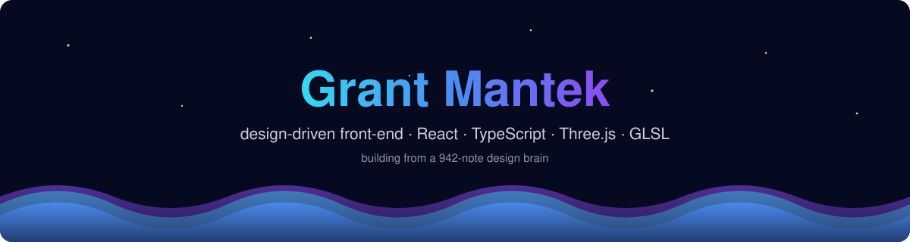

  

 

  Student &amp; hobbyist dev out of Charleston. 
  I collect UI, animation, and 3D knowledge into an Obsidian vault — <b>then build from it</b>. 
  Currently going deep on Three.js &amp; GLSL: scene graphs, PBR, shaders, glTF.

 

<table width="100%">
  <tr>
    <td width="50%" valign="top">
      <h3>🧊 3D &amp; shaders</h3>
      <ul>
        <li><a href="https://github.com/Grantmantek/fluxform"><b>fluxform</b></a> — Three.js GLSL shader toy</li>
        <li><a href="https://github.com/Grantmantek/threejs-shader-playground"><b>shader-playground</b></a> — live GLSL editor</li>
        <li><a href="https://github.com/Grantmantek/threejs-scroll-scene"><b>scroll-scene</b></a> — scroll-driven camera path</li>
        <li><a href="https://github.com/Grantmantek/threejs-product-configurator"><b>product-configurator</b></a> — swap materials, export PNG</li>
      </ul>
    </td>
    <td width="50%" valign="top">
      <h3>🎨 Canvas</h3>
      <ul>
        <li><a href="https://github.com/Grantmantek/canvas-particle-field"><b>particle-field</b></a> — pointer-reactive particles</li>
        <li><a href="https://github.com/Grantmantek/canvas-image-editor"><b>image-editor</b></a> — crop, rotate, adjust</li>
        <li><a href="https://github.com/Grantmantek/canvas-signature-pad"><b>signature-pad</b></a> — pressure-sensitive</li>
        <li><a href="https://github.com/Grantmantek/canvas-chart-lite"><b>chart-lite</b></a> — tiny animated charts</li>
      </ul>
    </td>
  </tr>
  <tr>
    <td width="50%" valign="top">
      <h3>🧱 Front-end</h3>
      <ul>
        <li><a href="https://github.com/Grantmantek/design-tokens-pipeline"><b>design-tokens-pipeline</b></a> — one JSON → CSS, Tailwind, TS</li>
        <li><a href="https://github.com/Grantmantek/tailwind-landing-kit"><b>tailwind-landing-kit</b></a> — accessible landing starter</li>
        <li><a href="https://github.com/Grantmantek/css-scroll-effects"><b>css-scroll-effects</b></a> — CSS-first scroll motion</li>
      </ul>
    </td>
    <td width="50%" valign="top">
      <h3>🤖 Hardware</h3>
      <ul>
        <li><a href="https://github.com/Grantmantek/robot-arm"><b>robot-arm</b></a> — Arduino arm, face tracking</li>
        <li><a href="https://github.com/Grantmantek/gesture-cam-rig"><b>gesture-cam-rig</b></a> — pan/tilt rig, gesture air-mouse</li>
      </ul>
    </td>
  </tr>
</table>

 

  TypeScript · React · Three.js · GLSL · Swift · Python · Tailwind · Supabase

 

  Anything public is forkable — thanks for stopping by 👋
    
  

